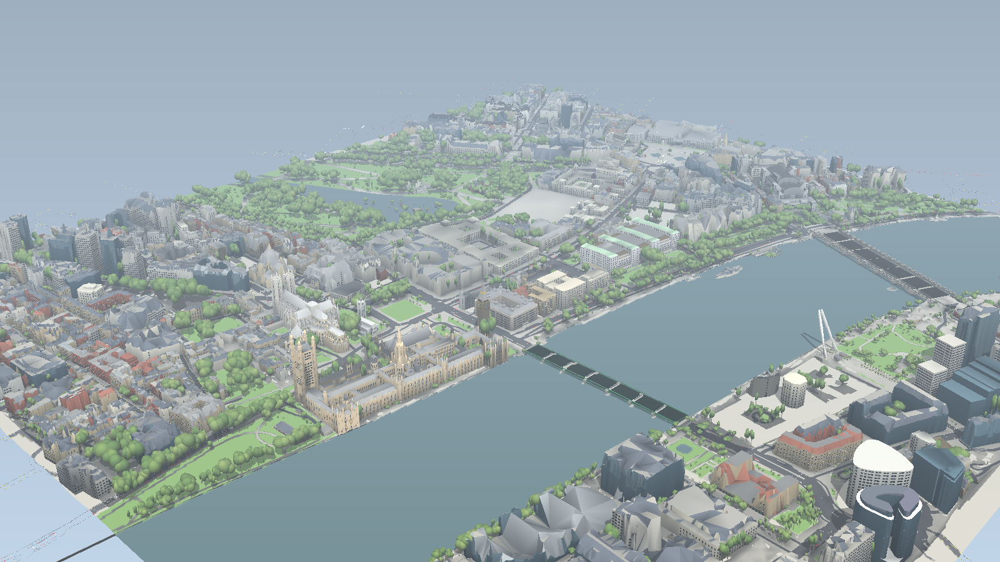
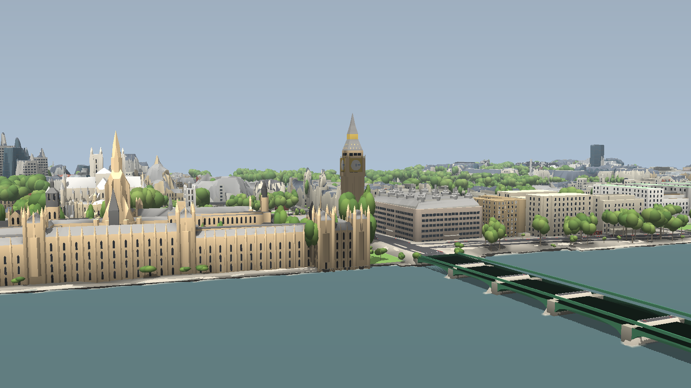

# GeoBlox — Westminster, reconstructed

A 1.4 × 1.5 km piece of central London rebuilt in Roblox from **open
measurement data**: Environment Agency LiDAR (1 m DTM + first-return DSM) and
OpenStreetMap. The area runs from Trafalgar Square to Westminster Abbey and
from Whitehall to the London Eye. Roofs are reconstructed from the LiDAR, road
widths are measured against mapped kerbs, and trees are segmented from the
canopy model. Everything renders as real meshes through `EditableMesh`.




The method, with references, is in [docs/DESIGN.md](docs/DESIGN.md). In short:
- **Roofs:** RANSAC planes, plane-intersection breaklines and a greedy-insertion
  TIN (Garland & Heckbert).
- **Landmarks:** mapped 3D parts (Simple 3D Buildings) for the Palace, the
  Abbey, Big Ben and Nelson's Column.
- **Streets:** carriageways measured by ray casting to mapped kerb lines,
  granite kerbs, and road markings to UK TSRGD patterns.
- **Rest of the scene:** bridge decks from LiDAR profiles, trees from watershed
  segmentation of the canopy height model, the London Eye's wheel plane from
  PCA of its LiDAR returns, and ambient occlusion baked from the city's own
  surface model.

## Try it

1. Open [`build/GeoBlox.rbxl`](build/GeoBlox.rbxl) in Roblox Studio and press
   **Play**. The terrain generates in parallel, you spawn on Westminster
   Bridge, and the city streams in around the camera.
2. If the HUD says **LITE (mesh APIs blocked)**, enable *Game Settings →
   Security → Allow Mesh & Image APIs* (published places also need an
   ID-verified owner, a Roblox rule), then play again. An up-to-date Studio is
   required for `EncodingService`.

| Key | Action |
|---|---|
| F | Fly (WASD, E/Space up, Q down, Shift fast) |
| V | Fast walk |
| 1–6 | Westminster Bridge · Parliament Square · Whitehall · Trafalgar Square · South Bank · Embankment |
| T / Y / R | +1 hour · pause time · next weather |
| H | Photo mode (hide HUD, depth of field) |

At night the lit windows, shopfronts, lanterns and Big Ben's dials come on. Big
Ben shows the current London time, the London Eye turns once every 30 minutes,
and Belisha beacons flash.

## Rebuild the data

```
cd pipeline
pip install -r requirements.txt
python -m geoblox.build --preview   # downloads LiDAR + OSM (cached), ~3 min
python -m pytest -q tests
```

The build writes `src/generated` (client mesh chunks plus the manifest),
`src/generated_server` (terrain), `build/report.json` and `build/preview_*.png`.
Then build the place:

```
rojo build default.project.json -o build/GeoBlox.rbxl
lune run tests/run          # decodes every generated chunk with the game's own parsers
```

## Data and licences

Contains Environment Agency LiDAR data © Environment Agency copyright and/or
database right 2022, used under the Open Government Licence v3. Map data ©
OpenStreetMap contributors, available under the Open Database Licence. The
attribution is also shown in the game's HUD.
