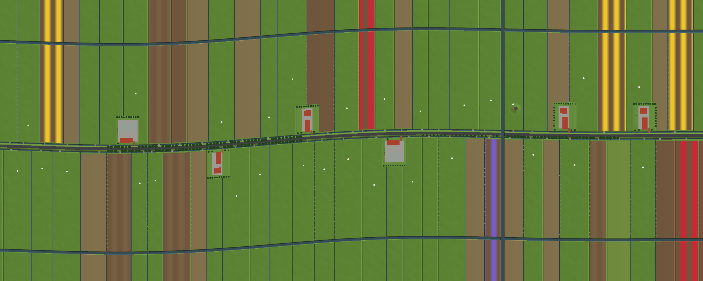

# GeoBlox

A lifelike, open-data rural world in Roblox, inspired by GeoCraftNL.
Full technical design: [docs/DESIGN.md](docs/DESIGN.md).

## Practice road (current build)

A procedurally generated Dutch polder road: about 1.5 × 0.6 km of real
terrain, plus a patchwork horizon out to ~5 km. There are no vehicles or
gameplay yet; this build is only map generation and looks.



What's in it:
- **Terrain** (server, parallel Actors): a dike road with a slight bend,
  roadside ditches, and long narrow parcels perpendicular to the road with a
  ditch on every boundary ("slagenlandschap"). Fields are crowned for
  drainage. A wetering runs parallel to the road, and a canal crosses under a
  brick bridge.
- **Fields**: pasture, maize, wheat, potatoes, and tulip, daffodil and
  hyacinth bulb fields in rows. They recolour per season.
- **Farms** in four regional types: hallehuis (with an owl board), Brabant
  langgevel, Noord-Holland stolp (pyramid thatch roof with a brick
  pronkgevel), and post-war brick. Each has tarred barns, steel sheds, silos,
  a manure silo, wrapped bales, a mailbox, front hedges, orchards and
  windbreaks.
- **Polder mill** on a mound, with turning sails and a tail pole. Far off
  there's a row of wind turbines and a church village.
- **Trees**: poplar and oak rows along the road, pollard willows along
  ditches, and lindens, chestnuts and apples at farms. Two LOD levels,
  streamed in rings around the camera.
- **Life**: Holstein, MRIJ, Blaarkop and Lakenvelder cattle and Texel sheep
  grazing inside their parcels. A starling flock, gulls, and grass that sways
  with the wind.
- **Sky**: a day cycle tuned for a Dutch sky, plus 5 weather types (including
  rain) and 4 seasons.

## How to test it

**Option A — open the built place (quickest)**
1. Download [`build/GeoBlox.rbxl`](build/GeoBlox.rbxl) from this branch.
2. Open it in Roblox Studio, then press **Play**. Terrain generates in a few
   seconds and you spawn on the road.

**Option B — live sync with Rojo**
1. Install [Rokit](https://github.com/rojo-rbx/rokit), then run `rokit install`
   in the repo.
2. Run `rojo serve` and connect from the Rojo Studio plugin. Edits then sync live.

**Controls**

| Key | Action |
|---|---|
| F | Toggle fly (WASD, E/Space up, Q down, Shift fast) |
| V | Toggle fast walk |
| 1 / 2 / 3 / 4 / 5 | Teleport: spawn / bridge / mill / next farm / aerial view |
| T | +1 hour |
| Y | Pause / resume time |
| R | Next weather |
| G | Next season |
| H | Photo mode (hide HUD, depth of field) |

The HUD shows FPS, terrain progress, decor part count and active animals. For
profiling, open the MicroProfiler (Ctrl+F6). Generation work is labelled
`GB:Terrain:*` and `GB:Decor:Build`.

## Development

```
rojo build default.project.json -o build/GeoBlox.rbxl   # build the place
lune run tests/run                                      # world-generation tests
lune run tools/preview 2                                # top-down map → build/preview.ppm
stylua src tests tools                                  # format
```

The world-generation core (`src/shared/Layout`, `Sampler`, `Rng`,
`TerrainChunk`) is pure and deterministic. The server, every client and the
Lune tests all build the identical world from `Config.SEED`. Change the seed
to get a different road.
