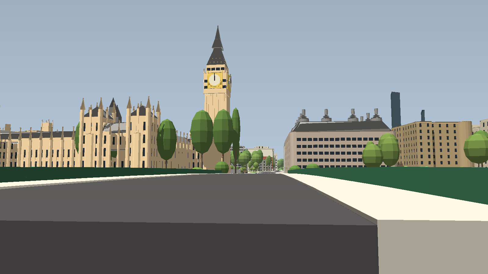

# GeoBlox — Westminster, rebuilt for driving

A 1.4 × 1.5 km piece of central London rebuilt in Roblox from **open
measurement data**: Environment Agency LiDAR (1 m DTM + first-return DSM) and
OpenStreetMap. It runs from Trafalgar Square to Westminster Abbey and from
Whitehall to the London Eye.

The approach mirrors the Minecraft converters (GeoCraft, Arnis), which map
measured geometry onto blocks, but the "blocks" here are **Roblox parts**:
- **264k parts**, baked into the place and streamed by the engine.
- **Roofs:** LoD2, reconstructed from the LiDAR.
- **Facades:** real window reveals.
- **Kerbs and markings:** measured kerbs and UK road markings.
- **Bridges:** decks that ramp onto their measured landfall.
- **Roads:** Roblox terrain, at heights from a robust fit of the DTM.

You start in a car on Westminster Bridge, facing Big Ben.





The method, with references and the research behind it, is in
[docs/DESIGN.md](docs/DESIGN.md).

## Play it

Open [`build/GeoBlox.rbxl`](build/GeoBlox.rbxl) in Roblox Studio and press
**Play**. Terrain roads generate in a few seconds (in parallel, nearest first),
then you are seated in a test car. No special game settings are needed: the
city is ordinary parts and terrain.

| Key | Action |
|---|---|
| W / S, arrows, gamepad, touch | Drive / brake / reverse |
| A / D | Steer |
| Left Shift | Handbrake |
| Space | Get out |
| C | New car here |
| L | Headlights |
| F | Fly (on foot; WASD, E/Space up, Q down, Shift fast) |
| 1–6 | Westminster Bridge · Parliament Square · Whitehall · Trafalgar Square · South Bank · Embankment |
| T / Y / R | +1 hour · pause time · next weather |
| H | Photo mode (hide HUD, depth of field) |

At night window bands, shopfronts, lanterns and Big Ben's dials light up and
signals cycle. Big Ben shows the current London time, the London Eye turns once
every 30 minutes, and Belisha beacons flash.

## Rebuild

```
cd pipeline
pip install -r requirements.txt
python -m geoblox.build --preview   # downloads LiDAR + OSM (cached), ~4 min
python -m pytest -q tests
cd ..
rojo build default.project.json -o build/GeoBlox.rbxl
lune run tools/bake build/GeoBlox.rbxl build/GeoBlox.rbxl   # bakes world/*.gbw into the place
lune run tests/run build/GeoBlox.rbxl                       # data + baked place checks
```

The pipeline writes:
- `world/` — part chunks for the baker;
- `src/generated` — the manifest;
- `src/generated_server` — terrain columns;
- `build/report.json` — statistics, including a drivability check of every
  road;
- `build/preview_*.png` — preview renders. To re-render them from the
  compiled world without rebuilding, run
  `python -m geoblox.preview [view ...]` in `pipeline/`.

Street furniture and trees are prefabs in
[`src/shared/Prefabs.luau`](src/shared/Prefabs.luau). Edit one and re-bake to
restyle every lamp column or tree.

## Data and licences

Contains Environment Agency LiDAR data © Environment Agency copyright and/or
database right 2022, used under the Open Government Licence v3. Map data ©
OpenStreetMap contributors, available under the Open Database Licence. The
attribution is also shown in the game's HUD.
